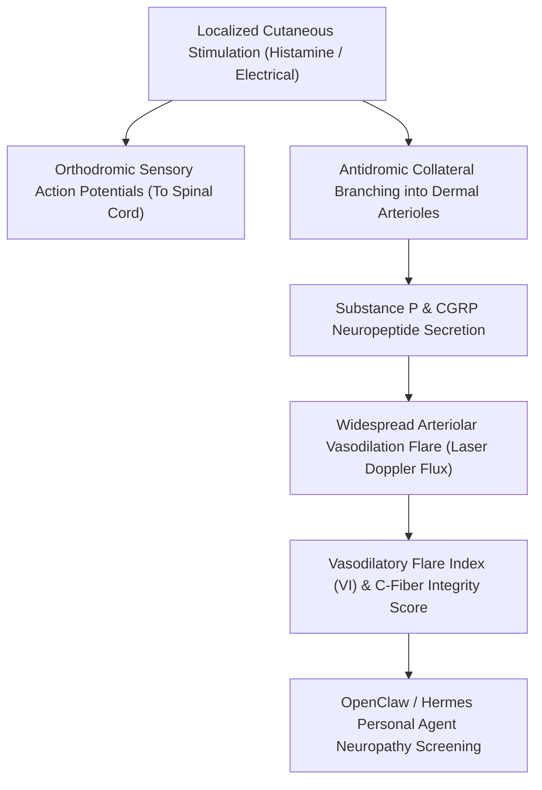

# Cutaneous Axon Reflex Flare (Laser Doppler) Skill

[](LICENSE)
[](https://www.python.org/)
[](requirements.txt)
[](mcp_server.py)
[](SKILL.md)

Zero-dependency sovereign personal agent skill for non-invasive evaluation of Cutaneous Axon Reflex Vasodilatory Index (PU_peak/PU_base), flare radius (mm), and unmyelinated nociceptive C-fiber axonal integrity.



## Features
- **Deterministic Math**: Pure Python standard library implementation with zero external dependencies.
- **Neurovascular Autonomic Standards**: Implements validated equations for Laser Doppler flux, Vasodilatory Index, and flare radius spread.
- **Small-Fiber Neuropathy Detection**: Highly sensitive detection of unmyelinated epidermal nerve fiber loss prior to standard nerve conduction studies.
- **Model Context Protocol (MCP)**: Native JSON-RPC tool integration for LLMs and autonomous agents.

## Quickstart

```python
from client import CutaneousAxonReflexFlareClient

client = CutaneousAxonReflexFlareClient()
result = client.evaluate_axon_reflex_flare(
    baseline_flux_pu=14.5,
    peak_flare_flux_pu=88.0,
    flare_radius_mm=19.5
)
print("Vasodilatory Index:", result["vasodilatory_index"], "x")
print("C-Fiber Score:", result["c_fiber_flare_score"])
print("Classification:", result["classification"])
```

## License
Apache-2.0
